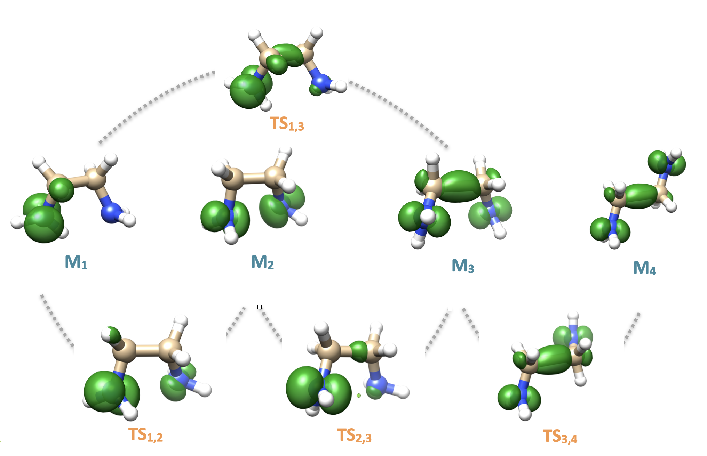

# Main Project
## Diamine PES Benchmark
# Diamine PES Benchmark

A modular Python package for analyzing, projecting, and benchmarking the Potential Energy Surface (PES) of the **diaminoethane radical cation** ($\text{C}_2\text{H}_8\text{N}_2^{+}$) across Density Functional Theory (DFT) approximations and Coupled-Cluster reference methods.

---

## Scientific Background & Objectives

Mixed-valence diamine radical cations present a stringent test for electronic-structure methods due to the delicate interplay between **electron correlation** and **self-interaction error (SIE)**. Unlike larger benchmark systems such as $N,N$-dimethylpiperazine ($\text{DMP}^{+}$), the smaller diaminoethane radical cation exhibits a rich PES featuring **four distinct minima** ($M_1–M_4$) and four connecting transition states ($\text {TS} _ {1,2}, \text{TS}_{1,3}, \text{TS}_{2,3}, \text{TS}_{3,4}$).

This repository provides a reproducible workflow to:
1. **Low-Dimensional PES Mapping (PCA):** Align stationary-point geometries and project the high-dimensional nuclear configuration space onto two principal components ($\text{PC}_1, \text{PC}_2$), colored by relative electronic energy ($\Delta E$ in $\text{eV}$).
2. **Topological & Energetic Benchmarking:** Evaluate **17 DFT functionals** spanning Jacob's ladder (GGA, meta-GGA, hybrid-GGA, hybrid-meta-GGA, range-separated hybrid, and double-hybrid) against high-level **Coupled-Cluster** benchmarks (up to $\text{CCSDT(Q)}$).
3. **Automated Manuscript Reporting:** Generate publication-ready figures and LaTeX/CSV energy tables across `cc-pVTZ` and `cc-pVQZ` basis sets.
## Code-Structure

```text
diamine_pes_benchmark/
├── __init__.py
├── models.py          # Core domain classes: StationaryPoint, ElectronicMethod, CalculationRecord, PESDataset
├── parsers.py         # XYZ/CSV readers, atom-order validation, and Kabsch structural alignment
├── projection.py      # GeometryProjector class for PCA and internal-coordinate embeddings
├── benchmark.py       # PESBenchmark class for topological coverage (M1 stability) & error metrics vs
├── reporting.py       # TableExporter class for LaTeX/CSV tables (cc-pVTZ, cc-pVQZ, Coupled Cluster)
├── visualization.py   # PESPlotter class for 2D PCA PES maps and energy profile diagrams
└── cli.py             # Command-line entry point tying the pipeline together
```
## Mathematical Formulation

### 1. Relative Energies & Barrier Heights
For a given electronic-structure method $m$ and basis set $b$, the relative electronic energy $\Delta E_i^{(m,b)}$ of stationary point $i$ (in $\text{eV}$) is referenced to the global minimum ($M_4$):

$$\Delta E_i^{(m,b)} = \left( E_i^{(m,b)} - E_{M_4}^{(m,b)} \right) \times 27.211386$$

where $E$ is the electronic energy in Hartree ($E_h$). Error metrics (MAE and RMSE) are evaluated on common stationary points against the Coupled-Cluster reference ($\Delta E_i^{\text{ref}}$):

$$\text{MAE}^{(m)} = \frac{1}{N_{\text{shared}}} \sum_{i=1}^{N_{\text{shared}}} \left\vert{} \Delta E_i^{(m)} - \Delta E_i^{\text{ref}} \right\vert{}$$

### 2. Structural Alignment & Principal Component Analysis (PCA)


## Potential Surface Visualization
### Spin-Density



#

